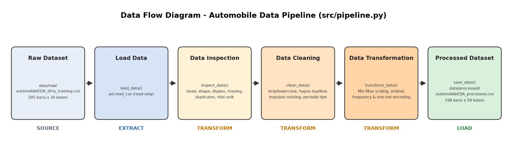

# Individual Assignment : Data Preparation & Pipeline Project

## 1. Deskripsi & Sumber Dataset

- **Isi dataset:** Spesifikasi teknis dan harga mobil (merek, tipe bodi, ukuran mesin, horsepower, konsumsi bahan bakar, harga, dll.)
- **Sumber:** `Dataset_Sesi_3.zip` yang berisi 3 file dataset, yaitu:
  - `data/raw/automobileEDA_dirty_training.csv` = **input utama pipeline**.
  - `data/reference/automobileEDA.csv` = dataset referensi (**tidak dipakai**)
  - `data/reference/automobile_processed.csv` = sebagai referensi/pembanding hasil (**tidak dipakai** juga).

## 2. Struktur Folder

```
data-pipeline-assignment/
├── data/
│   ├── raw/
│   │   └── automobileEDA_dirty_training.csv   # dataset mentah 
│   └── processed/
│       └── automobileEDA_processed.csv        # output pipeline
│   
├── src/
│   └── pipeline.py                            # pipeline ETL
├── documentation/
│   └── data-flow-diagram.png
│   
├── README.md
└── requirements.txt
```

## 3. Cara Menjalankan Program

```bash
# 1. buat virtual environment
python -m venv .venv
.venv\Scripts\activate          # Windows
# source .venv/bin/activate     # macOS / Linux

# 2. install dependency
pip install -r requirements.txt

# 3. jalankan pipeline dari root project
python src/pipeline.py
```

Seluruh hasil inspeksi, cleaning, dan transformasi akan tampil di terminal, lalu processed dataset akan otomatis dibuat di **`data/processed/`** dengan nama **`automobileEDA_processed.csv`**.


## 4. Alur ETL



| Tahap | Function di `pipeline.py` | Proses |
|---|---|---|
| **Extract** | `load_data()` | Membaca CSV dari `data/raw/` (read-only) |
| **Transform** | `inspect_data()` | Memeriksa struktur, tipe data, missing values, duplikat, nilai unik |
| | `clean_data()` | Menyeragamkan teks, menghapus duplikat, imputasi, memperbaiki tipe data |
| | `transform_data()` | Min-Max scaling dan encoding kategorikal |
| **Load** | `save_data()` | Menyimpan hasil ke `data/processed/automobileEDA_processed.csv` |


## 5. Kondisi Awal Dataset (Hasil Inspeksi)

| Aspek | Temuan |
|---|---|
| Ukuran awal | **205 baris × 30 kolom** |
| Missing values | Terdapat 17 sel kosong di 7 kolom, yaitu `stroke` (4 sel), `transaction_date` (2 sel), `make` (2 sel), `num-of-doors` (2 sel), `horsepower` (3 sel), `price` (3 sel), dan `horsepower-binned` (1 sel) |
| Duplikat | Terdapat **4 baris** identik pada dataset  |
| Tipe data belum sesuai | `transaction_date` masih berupa `object` (teks); lalu `num-of-doors` dan `num-of-cylinders` value-nya berupa angka dalam bentuk kata (`"two"`, `"four"`) |
| Kategori tidak konsisten | Pada kolom `make`: `ALFA-ROMERO`, `Audi`, `BMW`, serta spasi di belakang (`"dodge  "`, `"mercury  "`, `"porsche  "`); Pada kolom `body-style`: `SEDAN`, `Sedan`; Dan pada kolom `drive-wheels`: `AWD`, `RWD`; `fuel-system`: `MPFI`, `Mpfi` |
| Masalah lain | penulisan tanggal pada kolom `transaction_date` memakai **4 format berbeda** (`2025-01-01`, `02/01/2025`, `01-03-2025`, `04-Jan-2025`); lalu terdapat typo penulisan merek (`alfa-romero`, `peugot`); terdapat juga 4 nilai `stroke` kosong yang seluruhnya bertipe mesin **rotary Mazda** yang secara teknis tidak memiliki piston stroke; terakhir kolom `length` dan `width` yang sudah diisi dalam skala 0–1 sejak awal pada dataset |
| Nilai tidak wajar | Ada 14 outlier `price` menurut IQR, tetapi semuanya merupakan jenis mobil mewah (Jaguar, Mercedes-Benz, Porsche, BMW) sehingga dimaklumi |

## 6. Data Cleaning

| No | Masalah | Kolom | Metode | Alasan |
|---|---|---|---|---|
| 1 | Huruf besar/kecil dan spasi tidak konsisten | `make`, `body-style`, `drive-wheels`, `fuel-system` (+ kolom kategorikal lain) | `str.strip()` + `str.lower()` | `Sedan`, `SEDAN`, `sedan` adalah kategori yang sama. Tanpa diseragamkan, encoding akan menghasilkan kolom ganda |
| 2 | Typo nama merek | `make` | `alfa-romero → alfa-romeo`, `peugot → peugeot` | Nama merek yang benar memudahkan analisis dan penggabungan dengan data lain |
| 3 | Baris duplikat | semua | `drop_duplicates()` → **4 baris dihapus** | Duplikat membuat merek/transaksi tertentu terhitung ganda dan membiaskan statistik |
| 4 | `price` kosong (3) | `price` | **Baris dihapus** | `price` adalah variabel target yang tidak bisa diisi dengan nilai tebakan |
| 5 | Format tanggal campur + 2 kosong | `transaction_date` | Parsing eksplisit 4 format → `datetime` (`YYYY-MM-DD`); yang kosong diisi **interpolasi** dari tanggal sebelum/sesudahnya | Format diparsing satu per satu agar `02/01` (DD/MM) dan `01-03` (MM-DD) tidak tertukar. Transaksi tercatat harian dan berurutan, jadi tanggal yang hilang pasti berada di antara kedua tetangganya |
| 6 | `make` kosong (1 setelah deduplikasi) | `make` | Diisi dari **baris tetangga** apabila baris sebelum dan sesudahnya bermerek sama (hasil: `nissan`) | Dataset sudah terurut berdasarkan merek, sehingga merek bisa ditentukan dengan mudah. Jika baris atas dan bawahnya berbeda, nilai kolomnya akan diisi `unknown` |
| 7 | `num-of-doors` kosong (2) | `num-of-doors` | Modus per `body-style` (sedan → `four`) | Jumlah pintu sangat bergantung pada tipe bodi. Kedua baris yang kosong adalah sedan BMW/Mercedes yang umumnya memiliki 4 pintu |
| 8 | `horsepower` kosong (3) | `horsepower` | Median mobil dengan `engine-size` yang sama. Jika median pada `engine-size` tidak bisa ditentukan, cari median dari `horsepower-binned` | Tenaga mesin berkorelasi kuat dengan kapasitas mesin. |
| 9 | `horsepower-binned` kosong (1) | `horsepower-binned` | Diturunkan dari nilai `horsepower` memakai batas bin yang sudah ada di data (Low ≤ 101, Medium ≤ 155, sisanya High) | Kolom ini turunan langsung dari `horsepower` (Misalnya Jaguar 262 hp → `High`) |
| 10 | `stroke` kosong (4) | `stroke` | Median (3.29) | Semuanya mesin rotary yang tidak memiliki stroke, tetapi kolom harus numerik untuk pemodelan. Median tidak menggeser distribusi dan informasi rotary tetap ada di kolom `engine-type_rotor` |
| 11 | Angka dalam bentuk kata | `num-of-doors`, `num-of-cylinders` | Mapping kata → integer (`four → 4`) | Nilainya memang kuantitatif dan berurutan, jadi lebih tepat sebagai numerik daripada teks |

**Ringkasan hasil cleaning (dicetak oleh script):**

| | Sebelum | Sesudah |
|---|---|---|
| Jumlah baris | 205 | **198** (dikurangi 4 data duplikat dan 3 data price kosong) |
| Jumlah kolom | 30 | 30 |
| Total missing values | 17 | **0** |
| Kategori unik `make` / `body-style` / `drive-wheels` / `fuel-system` | 28 / 7 / 5 / 10 | 22 / 5 / 4 / 8 |

Kolom yang berubah: `transaction_date`, `make`, `num-of-doors`, `body-style`, `drive-wheels`, `num-of-cylinders`, `fuel-system`, `stroke`, `horsepower`, `horsepower-binned`.

## 7. Data Transformation

| Kolom | Metode | Alasan pemilihan | Kolom hasil |
|---|---|---|---|
| `curb-weight`, `engine-size`, `horsepower`, `peak-rpm`, `city-mpg`, `highway-mpg` | **Min-Max Scaling** `(x − min) / (max − min)` | Fitur numerik utama dengan skala sangat berbeda (curb-weight ribuan, mpg puluhan). Nilainya disamakan dalam range 0–1 agar tidak ada fitur yang mendominasi model berbasis jarak/gradien. `price` tidak di-scale karena merupakan target, sementara `length`/`width` sudah dalam range 0–1 | `<kolom>_scaled` (kolom asli dipertahankan untuk perbandingan) |
| `horsepower-binned` | **Ordinal encoding** Low=0, Medium=1, High=2 | Kategori ini memiliki urutan alami | `horsepower-binned_encoded` |
| `make` | **Frequency encoding** (proporsi kemunculan merek) | Terdapat 22 merek, di mana one-hot akan menambah 22 kolom sehingga frekuensi cukup ringkas | `make_freq` |
| `aspiration`, `body-style`, `drive-wheels`, `engine-location`, `engine-type`, `fuel-system` | **One-hot encoding** | Kategori nominal (tanpa urutan) dengan jumlah kategori kecil (2–8) | 27 kolom biner, mis. `body-style_sedan`; kolom teks asal diganti |

Pembersihan teks tambahan (strip, lowercase, perbaikan typo merek) dilakukan di tahap cleaning agar encoding menghasilkan kategori yang bersih.

### Contoh sebelum dan sesudah transformasi

**Min-Max Scaling**

| make | curb-weight | curb-weight_scaled | engine-size | engine-size_scaled | horsepower | horsepower_scaled | city-mpg | city-mpg_scaled |
|---|---|---|---|---|---|---|---|---|
| alfa-romeo | 2548 | 0.411171 | 130 | 0.260377 | 111 | 0.294393 | 21 | 0.222222 |
| alfa-romeo | 2823 | 0.517843 | 152 | 0.343396 | 154 | 0.495327 | 19 | 0.166667 |
| audi | 2337 | 0.329325 | 109 | 0.181132 | 102 | 0.252336 | 24 | 0.305556 |
| jaguar | 3950 | 0.955004 | 326 | 1.000000 | 262 | 1.000000 | 13 | 0.000000 |

**Encoding**

| Kolom asli | Nilai sebelum | Kolom sesudah | Nilai sesudah |
|---|---|---|---|
| `horsepower-binned` | Low / Medium / High | `horsepower-binned_encoded` | 0 / 1 / 2 |
| `make` | alfa-romeo | `make_freq` | 0.015152 |
| `make` | toyota | `make_freq` | 0.166667 |
| `body-style` | convertible | `body-style_convertible`, `body-style_hatchback`, `body-style_sedan`, … | 1, 0, 0, … |
| `body-style` | hatchback | `body-style_convertible`, `body-style_hatchback`, `body-style_sedan`, … | 0, 1, 0, … |
| `num-of-doors` (cleaning) | "two" / "four" | `num-of-doors` | 2 / 4 |
| `transaction_date` (cleaning) | `04-Jan-2025`, `02/01/2025` | `transaction_date` | `2025-01-04`, `2025-01-02` |

## 8. Hasil Akhir

| Tahap | Baris | Kolom |
|---|---|---|
| Raw dataset | 205 | 30 |
| Setelah cleaning | 198 | 30 |
| Processed dataset | **198** | **59** |

Processed dataset tersimpan di **`data/processed/automobileEDA_processed.csv`**: tanpa missing values, tanpa duplikat, tanggal dalam format ISO, seluruh fitur kategorikal sudah memiliki versi numerik (encoding), dan fitur numerik utama memiliki versi ter-scale 0–1. Kolom teks `make` dan `horsepower-binned` serta kolom numerik asli dipertahankan agar hasil tetap mudah dibaca dan dibandingkan.
